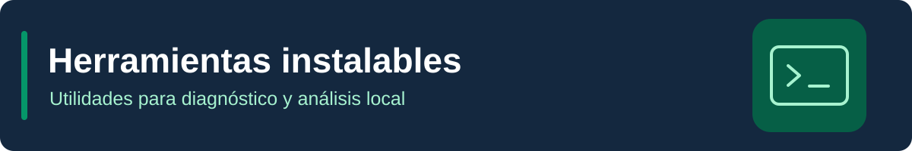

# Herramientas instalables

[Volver a la portada](../README.md) · [Ver herramientas web](../web/README.md)

  
  

| Herramienta | Modalidad | Para qué sirve |
| --- | --- | --- |
|  [QuickHash GUI](https://github.com/tedsmith/quickhash) | Escritorio | Calcula hashes de archivos y permite compararlos con los que publica el proveedor. |
|  [KeePassXC](https://keepassxc.org/download/) | Escritorio y opción portable para Windows | Guarda credenciales en una base de datos local cifrada. |
|  [Wireshark y TShark](https://www.wireshark.org/download.html) | Escritorio y línea de comandos | Permiten examinar capturas de tráfico para diagnosticar problemas como consultas DNS sin respuesta. |
|  [curl](https://curl.se/) | Línea de comandos | Sirve para diagnosticar conexiones HTTPS y revisar respuestas HTTP. |
| 📄 [evtx_dump](https://github.com/omerbenamram/evtx/releases) | Línea de comandos | Lee registros de eventos de Windows exportados en formato EVTX. |
|  [jq](https://jqlang.org/download/) | Línea de comandos | Permite filtrar y transformar registros en formato JSON. |
|  [Autoruns](autoruns/README.md) | Portable para Windows | Identifica qué programas y tareas se inician automáticamente. |
|  [Process Explorer](process-explorer/README.md) | Portable para Windows | Identifica qué proceso tiene abierto un archivo o ha cargado una DLL. |
