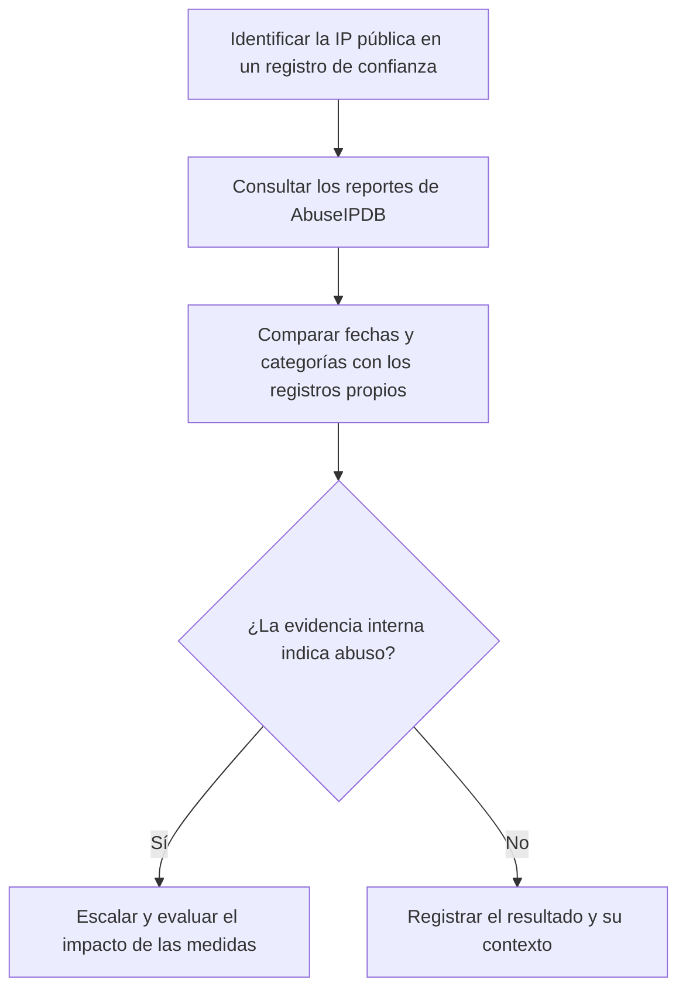

#  AbuseIPDB

[Volver al catálogo web](../README.md) · [Volver a la portada](../../README.md#qué-necesitas-resolver) · [Abrir AbuseIPDB](https://www.abuseipdb.com/)

  
  

AbuseIPDB recopila reportes de abuso. Su puntuación de confianza va de 0 a 100 y se basa en los reportes recibidos, con factores como la diversidad de quienes reportan y la antigüedad de los reportes. Úsala junto con los registros del servicio que estás investigando.

## Revisar reportes de abuso sobre una IP

**Situación.** El registro de un portal muestra varios intentos de inicio de sesión fallidos desde la misma IP. Necesitas revisar si existen reportes de actividad similar y decidir si corresponde escalar.

**Antes de empezar.** Ten a mano la hora del evento, el servicio afectado y la IP pública de origen que consta en un registro de confianza. Si hay un proxy o CDN, comprueba qué campo identifica al cliente según la configuración del servicio. La herramienta recibe la IP consultada. Conserva usuarios, cabeceras completas y registros en el canal interno.

### Pasos

1. Abre AbuseIPDB y busca la IP pública observada.
2. Verifica que la ficha corresponda a la IP exacta. Revisa la puntuación, las fechas, las categorías y los reportantes distintos si el informe muestra esos datos.
3. Compara los reportes con los registros propios. Revisa si hubo accesos exitosos además de los fallidos, qué cuentas o servicios estuvieron involucrados y si la IP pertenece a una red compartida o a un proveedor conocido.
4. Si las evidencias internas sugieren abuso o un acceso no autorizado, deriva el caso por el canal de incidentes. Si se evalúa bloquear la IP, considera el impacto sobre usuarios legítimos y aplica el procedimiento del equipo responsable.

### Cómo interpretar el resultado

| Hallazgo | Qué hacer |
| --- | --- |
| Hay reportes recientes en categorías que coinciden con el evento. | Adjunta el enlace a la ficha y el contexto de tus registros para que el equipo evalúe el alcance. |
| Los reportes son antiguos o describen otra actividad. | Úsalos como contexto y sigue investigando el evento que observaste. Una IP compartida puede representar a varios usuarios. |
| La IP no tiene reportes o el puntaje es bajo. | Registra el resultado de la consulta. Si los registros internos muestran señales de abuso, continúa la investigación. |

**Para el ticket**, registra la IP, las horas del evento y de la consulta, las categorías relevantes, el enlace a la ficha y el resultado de contrastar el reporte externo con los registros internos.

Fuentes · [AbuseIPDB](https://www.abuseipdb.com/) · [Preguntas frecuentes y puntuación de confianza](https://www.abuseipdb.com/faq.html)
