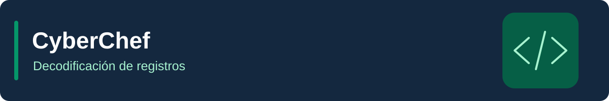
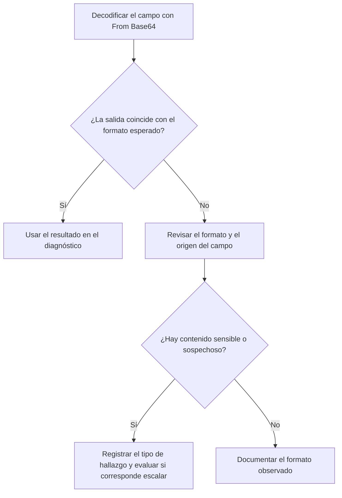

#  CyberChef

[Volver al catálogo web](../README.md) · [Volver a la portada](../../README.md#qué-necesitas-resolver) · [Abrir CyberChef](https://gchq.github.io/CyberChef/)

  
  

CyberChef es una herramienta de código abierto que transforma datos mediante operaciones en el navegador. Puedes encadenar operaciones en el panel **Recipe** y revisar su resultado en **Output**.

## Decodificar un campo Base64 de un registro

**Situación.** Un registro de una integración contiene un campo en Base64 y necesitas leer su contenido para entender un error de soporte. Base64 representa datos con caracteres de texto y se puede revertir sin una clave.

**Antes de empezar.** Confirma en la documentación de la aplicación si el campo usa Base64 y si espera texto o bytes. El ejercicio usa datos de ejemplo. La aplicación oficial procesa los datos en el navegador. Para registros internos, usa una copia local aprobada si tu organización lo requiere y evita compartir enlaces de receta que incluyan la entrada.

### Pasos

1. Abre CyberChef y pega solo el valor del campo en **Input**.
2. Busca **From Base64** en **Operations** y arrástrala al panel **Recipe**.
3. Lee la salida en **Output**. Si la ejecución automática está desactivada, pulsa **Bake!**.
4. Compara la salida con el formato esperado del campo. Si el resultado contiene una URL, un comando o un token, trátalo como texto al documentar el hallazgo.

### Ejemplo reproducible

| Panel | Valor |
| --- | --- |
| **Input** | `RXJyb3IgZGUgY29uZXhpb24=` |
| **Recipe** | `From Base64` |
| **Output** | `Error de conexion` |

### Cómo interpretar el resultado

| Resultado | Siguiente paso |
| --- | --- |
| El texto coincide con el formato esperado. | Usa el mensaje para revisar el error de la integración y guarda un extracto pertinente en el ticket. |
| La salida contiene caracteres extraños o bytes. | Revisa el formato documentado. Base64 también puede representar datos binarios. |
| La salida contiene una URL, un comando o una credencial inesperados. | Registra el tipo de hallazgo sin abrir la URL, ejecutar el comando ni copiar el secreto al ticket. Deriva el caso si corresponde. |

**Para el ticket**, registra el nombre del campo, su origen, la operación aplicada y el resultado relevante. Omite los datos sensibles del extracto.

Fuentes · [CyberChef y documentación del proyecto](https://github.com/gchq/CyberChef) · [Aplicación web oficial](https://gchq.github.io/CyberChef/)
