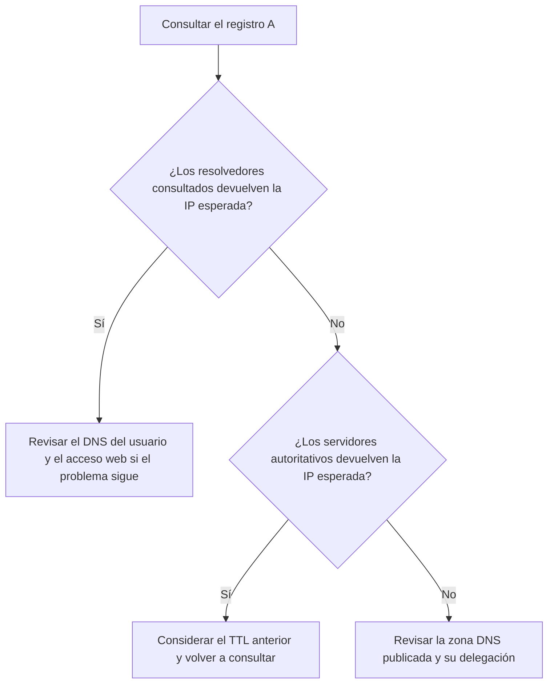

# DNSChecker

[Volver al catálogo web](../README.md) · [Abrir DNSChecker](https://dnschecker.org/)

DNSChecker consulta registros DNS públicos desde distintos resolvedores. En soporte TI, sirve para comprobar qué respuesta obtienen usuarios de distintas redes después de un cambio. La consulta se realiza mediante un servicio externo. Usa nombres de dominio públicos.

## Comprobar un cambio de registro A

**Situación.** Después de mover un sitio a otro servidor, algunos usuarios siguen llegando al anterior. El objetivo es comprobar si los resolvedores públicos devuelven la nueva dirección IPv4.

**Antes de empezar.** Ten a mano el nombre completo del sitio, la IP anterior, la nueva y la hora del cambio. Si conoces el TTL anterior, regístralo. El TTL indica cuánto tiempo se puede conservar una respuesta en caché.

### Pasos

1. Abre DNSChecker e ingresa el nombre completo del sitio, sin `https://` ni rutas.
2. Selecciona el tipo de registro **A** y pulsa **Search**.
3. Compara las IP que devuelve cada resolvedor con la dirección esperada. Si el sitio usa varias IP, compara el conjunto esperado sin importar el orden.
4. Registra la hora con su zona horaria y anota qué resolvedores devuelven la IP nueva, la anterior o un error. Repite la consulta después de revisar el TTL si persiste una mezcla de respuestas.

### Ejemplo ilustrativo

Supongamos que `www.example.com` debe pasar de `192.0.2.10` a `192.0.2.20`. Los nombres y las direcciones se usan como ejemplo y los resultados de la tabla son simulados.

| Consulta | Respuesta observada | Qué revisar |
| --- | --- | --- |
| Resolvedor A | `192.0.2.20` | Ya devuelve la IP esperada. |
| Resolvedor B | `192.0.2.10` | Revisa la respuesta de los servidores autoritativos y considera el TTL anterior antes de repetir la consulta. |
| Resolvedor C | Error o sin respuesta | Repite la prueba y comprueba el nombre y el tipo de registro. Si persiste, verifica el estado del DNS autoritativo. |

### Qué hacer con el resultado

Si el DNS público ya devuelve la IP esperada y el usuario sigue viendo el sitio anterior, comprueba qué respuesta obtiene desde su red. Luego revisa HTTPS o la aplicación si el equipo ya resuelve la IP correcta. DNSChecker muestra una selección de resolvedores públicos y la consulta del registro A por sí sola no comprueba que el sitio cargue.

**Para el ticket**, deja el nombre consultado, el tipo de registro, el valor esperado, las respuestas observadas, la hora y el siguiente paso.

Fuentes · [DNSChecker](https://dnschecker.org/) · [Cloudflare DNS, preguntas frecuentes sobre cambios y caché](https://developers.cloudflare.com/dns/faq/)
