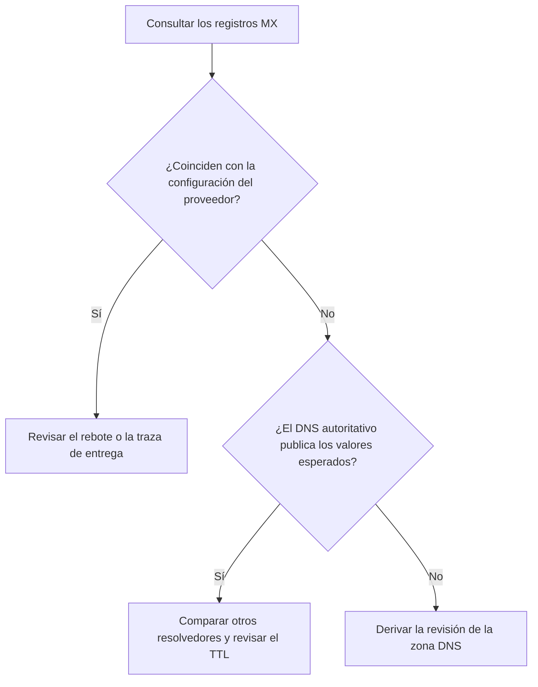

#  Google Admin Toolbox Dig

[Volver al catálogo web](../README.md) · [Volver a la portada](../../README.md#qué-necesitas-resolver) · [Abrir Dig](https://toolbox.googleapps.com/apps/dig/)

Dig permite consultar registros DNS públicos desde el navegador. Para diagnosticar correo entrante, puedes usarlo para revisar qué servidores anuncia el dominio en sus registros MX y comparar la respuesta con la configuración del proveedor.

## Revisar los registros MX después de una migración de correo

**Situación.** El equipo migró el correo a un proveedor nuevo. Algunos mensajes enviados desde fuera de la organización todavía llegan al proveedor anterior o se devuelven.

**Antes de empezar.** Ten a mano el dominio que aparece después de la arroba, la lista de servidores y prioridades indicadas por el proveedor, y la hora del cambio. El servicio de Google recibe el nombre que consultes. Usa el dominio público, sin ingresar una dirección de correo completa.

### Pasos

1. Abre Dig y escribe el dominio en **Name**. Para `usuario@example.com`, consulta `example.com`.
2. Selecciona **MX** y revisa los registros que aparecen. Cada registro identifica un servidor y un valor de preferencia. Un número menor indica mayor preferencia.
3. Compara **todos** los destinos y prioridades con los del proveedor, incluidos los servidores de respaldo. Un punto al final del nombre del servidor representa un nombre DNS completo.
4. Si aparece una diferencia, comprueba qué publican los servidores autoritativos. Si ya publican el valor esperado, considera la caché y el TTL anterior. Puedes usar [DNSChecker](../dnschecker/README.md) con el tipo **MX** para comparar otros resolvedores.
5. Si los registros coinciden y el correo sigue fallando, pide un mensaje de rebote o revisa la traza de entrega. Usa esos datos para comprobar si el proveedor aceptó, rechazó o puso en cuarentena el mensaje.

### Cómo interpretar el resultado

Supongamos que el proveedor nuevo indica dos destinos para `example.com`. Los valores de la tabla son simulados.

| Respuesta de ejemplo | Qué revisar |
| --- | --- |
| `10 mx1.correo-nuevo.example.` y `20 mx2.correo-nuevo.example.` | Ambos destinos coinciden. El de preferencia 10 se intenta antes que el de 20. Si el problema sigue, revisa la traza o el rebote. |
| También aparece `5 mx.correo-anterior.example.` | El servidor anterior tiene mayor preferencia. Verifica si debía retirarse y si el valor sigue publicado en el DNS autoritativo. |
| Dig no devuelve registros MX o muestra un error. | Revisa que escribiste el dominio correcto. Comprueba la respuesta autoritativa antes de concluir que falta el registro o de cambiar la zona. |

**Para el ticket**, registra el dominio, la hora y zona horaria de la consulta, los destinos y prioridades observados, la configuración esperada y el código de rebote si existe.

Fuentes · [Google Admin Toolbox Dig](https://toolbox.googleapps.com/apps/dig/) · [Ayuda de Google Workspace sobre recepción de correo](https://support.google.com/a/troubleshooter/2784822) · [RFC 5321, sección 5.1](https://www.rfc-editor.org/rfc/rfc5321.html#section-5.1)
