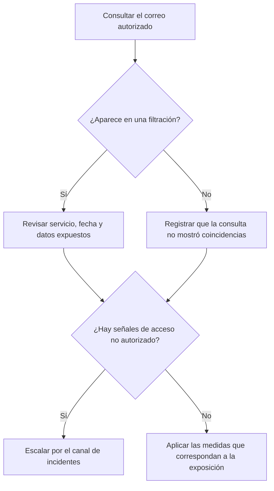

#  Have I Been Pwned

[Volver al catálogo web](../README.md) · [Volver a la portada](../../README.md#qué-necesitas-resolver) · [Abrir Have I Been Pwned](https://haveibeenpwned.com/)

Have I Been Pwned (HIBP) permite consultar si una dirección de correo figura en el catálogo de filtraciones del servicio. Sirve para evaluar una posible exposición de datos en un servicio externo y decidir qué revisar en la cuenta.

## Revisar si un correo aparece en una filtración

**Situación.** Una persona recibe un aviso sobre una filtración de un servicio donde tiene una cuenta y pregunta a soporte qué medidas debe tomar.

**Antes de empezar.** Para una cuenta personal, el titular puede hacer la consulta. Para un correo corporativo, usa el procedimiento autorizado de tu organización o guía al titular para que haga la consulta. El sitio recibe la dirección que ingresas. La búsqueda se realiza con el correo electrónico y no requiere introducir su contraseña.

### Pasos

1. Abre Have I Been Pwned e ingresa la dirección de correo en el formulario de búsqueda.
2. Si hay coincidencias, abre el detalle y anota el nombre del servicio afectado, la fecha de la filtración y las clases de datos expuestos.
3. Revisa si la persona conserva una cuenta en ese servicio y si reutilizó la contraseña. Pregúntale por la reutilización, sin pedirle que revele la contraseña.
4. Si hay señales de acceso no autorizado, como inicios de sesión desconocidos, escala por el canal de incidentes. Si hay exposición de credenciales, sigue el procedimiento de recuperación y revisa la autenticación multifactor (MFA).

### Cómo interpretar el resultado

| Resultado | Siguiente paso |
| --- | --- |
| La filtración incluye contraseñas. | Cambia la contraseña del servicio afectado si sigue vigente y también la de cualquier otra cuenta donde se haya reutilizado. Habilita MFA donde esté disponible. |
| La filtración muestra datos como correo o teléfono. | Revisa qué datos se expusieron y considera el riesgo de mensajes de phishing dirigidos. |
| La búsqueda pública no muestra coincidencias. | Registra el resultado como ausencia de coincidencias en esa consulta. Algunas filtraciones sensibles solo se muestran al titular verificado y el catálogo tiene cobertura parcial. Si hay actividad sospechosa, sigue revisando los registros de acceso. |

Una coincidencia indica que la dirección figura en datos asociados a una filtración. Para determinar si alguien accedió a la cuenta actual, revisa por separado la actividad y las alertas del proveedor de identidad.

**Para el ticket**, deja la fecha de consulta, el servicio afectado, el tipo de datos expuestos y las acciones acordadas. Registra esos detalles en el sistema interno autorizado.

Fuentes · [Preguntas frecuentes de Have I Been Pwned](https://haveibeenpwned.com/FAQs) · [Catálogo de filtraciones](https://haveibeenpwned.com/PwnedWebsites)
