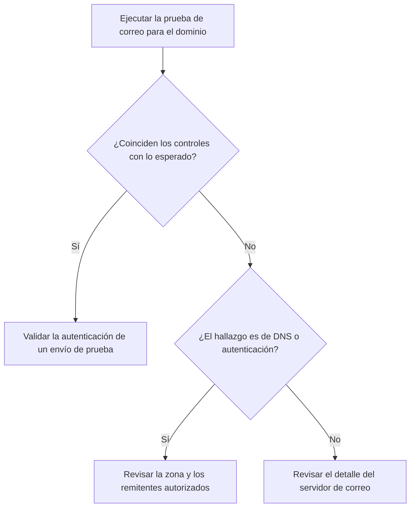

#  Internet.nl

[Volver al catálogo web](../README.md) · [Volver a la portada](../../README.md#qué-necesitas-resolver) · [Abrir Internet.nl](https://en.internet.nl/)

  
  

Internet.nl es una herramienta de código abierto para verificar la adopción de estándares de Internet. Su prueba de correo revisa, entre otros controles, autenticación (SPF, DKIM y DMARC), transporte (STARTTLS y DANE) y DNSSEC. El informe muestra una puntuación general y el detalle de cada prueba.

## Verificar la seguridad del correo de un dominio

**Situación.** El equipo acaba de configurar un dominio para enviar y recibir correo. Necesitas comprobar qué controles están publicados y qué partes del servicio requieren una validación adicional.

**Antes de empezar.** Ten a mano el dominio público, los proveedores autorizados para enviar correo y la configuración esperada. El sitio recibe el nombre consultado. Usa solo el dominio, sin escribir una dirección completa ni adjuntar un mensaje.

### Pasos

1. Abre Internet.nl y busca **Test your email**. Ingresa el dominio, como `example.com`, e inicia la prueba. Usa el dominio de tu organización para una verificación real.
2. Abre el detalle del informe y revisa primero la sección de autenticación del correo. Compara los hallazgos de **SPF** y **DMARC** con la política esperada.
3. Revisa el estado de **STARTTLS**, **DANE** y **DNSSEC**. Si el informe entrega resultados por servidor de correo, anota qué servidor presenta el hallazgo.
4. Para validar **DKIM y DMARC en un envío real**, envía un mensaje de prueba desde cada plataforma relevante a un buzón controlado. Revisa en el destinatario los resultados de autenticación y si SPF o DKIM se alinean con el dominio del remitente visible para DMARC. Usa el informe web para revisar la configuración publicada.

### Cómo interpretar el resultado

| Hallazgo | Qué revisar |
| --- | --- |
| DMARC falta o aparece con `p=none`. | Comprueba si hay una política publicada y si la organización se encuentra en una etapa de monitoreo. `p=none` indica que el dominio no solicita cuarentena ni rechazo por fallos de DMARC. Antes de endurecer la política, verifica el correo legítimo de tus proveedores. |
| SPF falta o presenta errores de sintaxis. | Revisa el registro publicado y el inventario de servicios autorizados. Después de corregirlo, comprueba un envío de prueba. |
| Hay un hallazgo de STARTTLS o DANE. | Revisa el detalle para distinguir un problema de negociación TLS de un hallazgo sobre DANE. Deriva al administrador del servidor que recibe correo o a quien gestiona DNS, según el resultado. |
| Los controles publicados coinciden con lo esperado. | Conserva el resultado y completa la validación con mensajes de prueba. La puntuación corresponde a los controles evaluados para ese dominio. |

**Para el ticket**, guarda el dominio, la fecha y hora de la prueba, el enlace al informe, el control observado y el valor esperado. Si revisaste un envío de prueba, registra el resultado de autenticación sin copiar datos del mensaje que no sean necesarios.

Fuentes · [Alcance de la prueba de correo](https://en.internet.nl/test-mail/) · [DMARC, DKIM y SPF](https://en.internet.nl/faqs/mailauth/) · [STARTTLS y DANE](https://en.internet.nl/faqs/starttls/) · [Código fuente de Internet.nl](https://github.com/internetstandards/Internet.nl)
