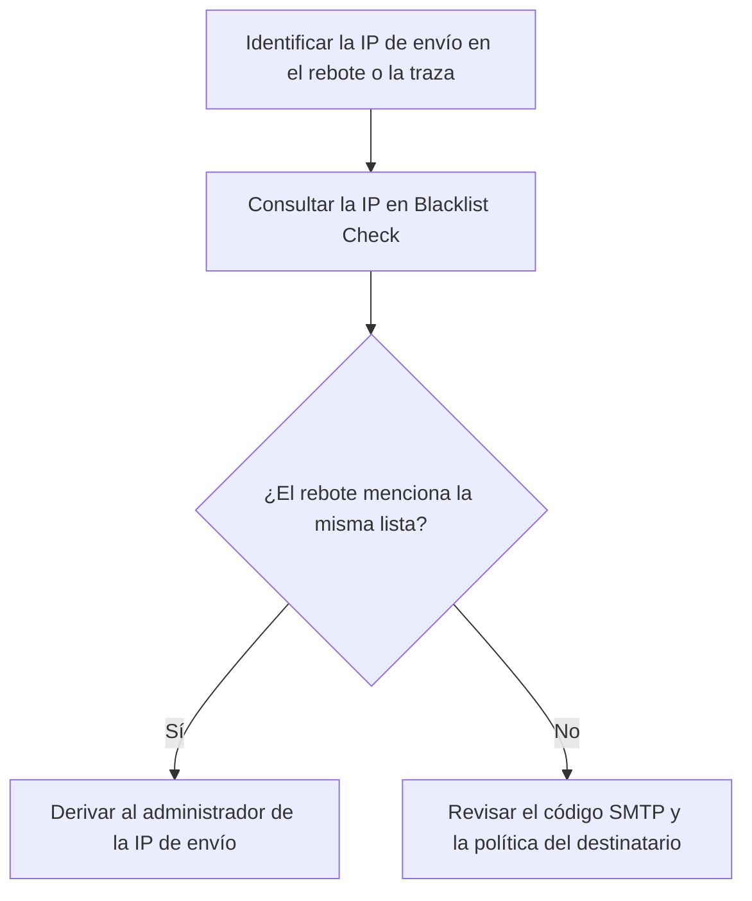

#  MXToolbox SuperTool

[Volver al catálogo web](../README.md) · [Volver a la portada](../../README.md#qué-necesitas-resolver) · [Abrir SuperTool](https://mxtoolbox.com/SuperTool.aspx)

  
  

SuperTool reúne consultas de diagnóstico. Su función **Blacklist Check** permite comprobar si una IP de envío aparece en listas de bloqueo públicas.

## Investigar un rechazo de correo por reputación de IP

**Situación.** Un destinatario externo rechaza un mensaje. El aviso de entrega fallida menciona una IP o una política de reputación. Necesitas correlacionar el rebote con lo que informan las listas públicas.

**Antes de empezar.** Conserva el código SMTP, el texto del rechazo y la hora con su zona horaria. Identifica en el rebote o la traza la IP pública que presentó el mensaje al destinatario. Los registros MX del dominio indican a dónde recibe correo y pueden apuntar a servidores distintos de los que lo envían. Para la consulta externa usa solo la IP pública y guarda el contenido del mensaje y del rebote en el canal interno.

### Pasos

1. Abre [Blacklist Check](https://mxtoolbox.com/blacklists.aspx) desde MXToolbox e ingresa la IP pública de envío.
2. Revisa los resultados por lista. Si hay una coincidencia, anota el nombre de la lista, el motivo si está disponible y la hora de consulta.
3. Compara el resultado con el texto del rebote. Si el destinatario menciona la misma lista, deriva al administrador del servicio de envío o al proveedor que gestiona esa IP.
4. Si la consulta no muestra coincidencias, revisa la política indicada en el rebote y la traza. El destinatario puede aplicar filtros propios o rechazar por motivos de autenticación, contenido o límites de envío.

### Cómo interpretar el resultado

| Hallazgo | Siguiente paso |
| --- | --- |
| El rebote menciona la misma lista que muestra MXToolbox. | Adjunta la coincidencia al ticket. Coordina con quien administra la IP la investigación de la causa y, si corresponde, la solicitud de retiro después de corregirla. |
| La IP aparece en una lista distinta de la mencionada en el rebote. | Registra el hallazgo como contexto y sigue investigando el motivo que dio el destinatario. |
| La consulta no muestra coincidencias. | Revisa el código SMTP, la autenticación del mensaje y la política del destinatario. Una consulta posterior al rechazo refleja el estado al momento de la prueba. |

**Para el ticket**, registra la IP de envío, la hora y zona horaria, el código SMTP, el texto pertinente del rechazo y las listas observadas. Tras una corrección, confirma el resultado con un nuevo envío controlado y su traza.

Fuentes · [MXToolbox Blacklist Check](https://mxtoolbox.com/blacklists.aspx) · [Documentación de herramientas de entrega](https://knowledgebase.mxtoolbox.com/home/email-delivery-tools)
