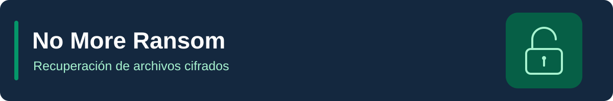
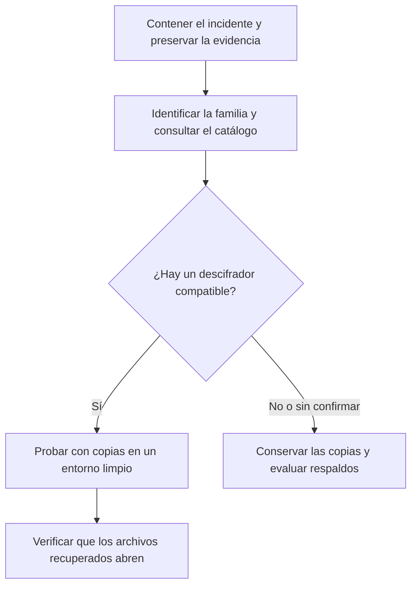

#  No More Ransom

[Volver al catálogo web](../README.md) · [Volver a la portada](../../README.md#qué-necesitas-resolver) · [Abrir No More Ransom](https://www.nomoreransom.org/)

  
  

No More Ransom mantiene un catálogo de herramientas de descifrado para variantes específicas de ransomware. **Crypto Sheriff** ayuda a identificar la familia mediante muestras cifradas y datos de la nota de rescate. Los descifradores del catálogo se descargan y se ejecutan de acuerdo con el instructivo de cada proveedor.

## Buscar un descifrador para archivos afectados por ransomware

**Situación.** Un usuario ya no puede abrir varios documentos. Los archivos tienen una extensión nueva y apareció una nota de rescate. El equipo de respuesta necesita saber si existe una opción de recuperación.

**Antes de empezar.** Activa el procedimiento de respuesta de tu organización y coordina con el equipo responsable la contención y preservación de evidencia. Conserva la nota y los archivos originales sin modificarlos.

### Pasos

1. Registra la extensión añadida y conserva la nota de rescate. Si el equipo de respuesta ya identificó la familia o variante, busca directamente ese nombre en el [catálogo de descifradores](https://www.nomoreransom.org/en/decryption-tools.html).
2. Si falta identificar la familia, revisa con el equipo si corresponde usar [Crypto Sheriff](https://www.nomoreransom.org/crypto-sheriff.php?lang=en). El formulario permite adjuntar hasta dos muestras cifradas de hasta **1 MB por archivo** e ingresar indicadores de la nota. Las muestras se envían al servicio. Usa solo copias aprobadas para compartir y mantén los archivos sensibles en el canal interno.
3. Si el catálogo ofrece un descifrador, abre su instructivo y compara las variantes y requisitos con los del incidente. Descárgalo desde el enlace del proveedor indicado en el catálogo.
4. Con la contención y la erradicación verificadas por el equipo de respuesta, prueba primero con copias en un entorno de recuperación limpio. Comprueba que los archivos recuperados abran correctamente antes de ampliar la recuperación.

### Cómo interpretar el resultado

| Resultado | Siguiente paso |
| --- | --- |
| Hay un descifrador compatible con la variante. | Valida los requisitos y prueba con un conjunto pequeño de copias. |
| Hay un descifrador para la familia, pero la variante sigue sin confirmarse. | Revisa la compatibilidad con el proveedor o el equipo de respuesta antes de aplicarlo. |
| No hay coincidencia o descifrador disponible. | Conserva las copias cifradas y evalúa la restauración desde respaldos verificados. |

**Para el ticket**, registra la hora del hallazgo, los sistemas afectados, la familia o variante si se confirmó, el enlace al descifrador evaluado y el resultado de la prueba o la decisión de restaurar desde respaldo. Mantén las muestras en el espacio de evidencia autorizado.

Fuentes · [Crypto Sheriff](https://www.nomoreransom.org/crypto-sheriff.php?lang=en) · [Catálogo e instructivos de No More Ransom](https://www.nomoreransom.org/en/decryption-tools.html) · [Guía de respuesta ante ransomware de CISA](https://www.cisa.gov/stopransomware/ransomware-guide)
