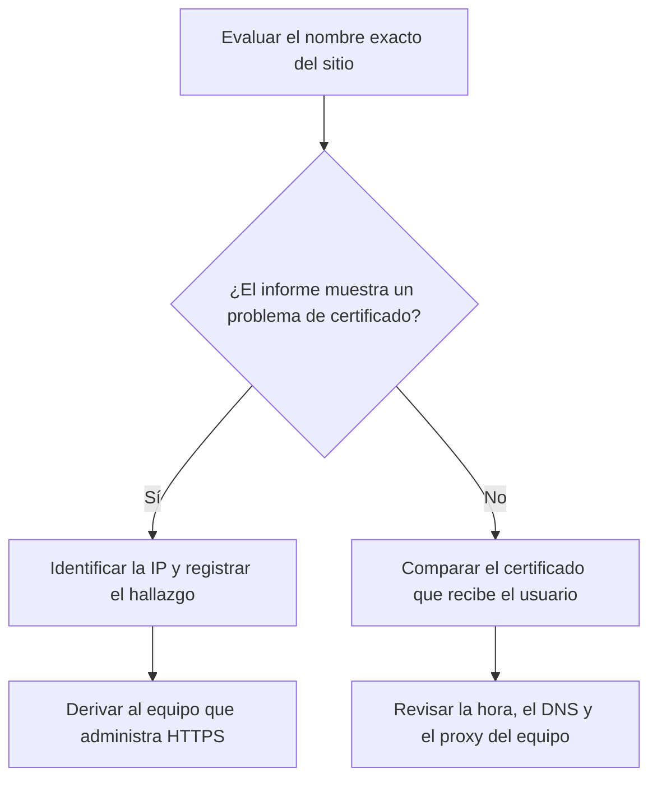

#  Qualys SSL Labs

[Volver al catálogo web](../README.md) · [Volver a la portada](../../README.md#qué-necesitas-resolver) · [Abrir SSL Server Test](https://www.ssllabs.com/ssltest/)

SSL Server Test revisa desde Internet el certificado y la configuración TLS que presenta un sitio público. En soporte TI sirve para comprobar si una advertencia del navegador también aparece al evaluar el servicio desde fuera de la red del usuario.

## Diagnosticar una advertencia de certificado HTTPS

**Situación.** Después de renovar el certificado de un portal, un usuario informa que el navegador muestra una advertencia de seguridad.

**Antes de empezar.** Registra el nombre exacto del sitio que aparece en el navegador, el texto del error y la hora. Usa un sitio público que administres o tengas autorización para evaluar. La prueba envía el nombre del sitio a Qualys.

### Pasos

1. Ingresa el nombre en **Hostname**, por ejemplo `portal.example.com`, sin `https://`, rutas ni parámetros. Ese nombre es ilustrativo.
2. Marca **Do not show the results on the boards** si quieres que el resultado quede fuera de los listados del sitio. Inicia la prueba.
3. Si el informe muestra varias direcciones IP, abre el detalle de cada una. Compara el nombre cubierto por el certificado, sus fechas de vigencia y los avisos sobre la cadena de confianza.
4. Relaciona el hallazgo con el error informado. Si la prueba devuelve una alerta de certificado en algún servidor, deriva el caso al equipo que administra el componente que entrega HTTPS, como el balanceador, el CDN o el servidor web.

### Cómo interpretar el resultado

| Hallazgo | Siguiente paso |
| --- | --- |
| El certificado aparece vencido. | Comprueba si el servidor está entregando el certificado renovado. Registra la fecha de vencimiento y la IP donde se observó. |
| El certificado no cubre el nombre consultado. | Revisa los nombres incluidos en el certificado y la configuración HTTPS del sitio en el componente que presenta el certificado. |
| El informe señala una cadena incompleta. | Verifica si el servidor entrega los certificados intermedios requeridos por la autoridad certificadora. |
| Solo una IP presenta el problema. | Compara la configuración de ese servidor con la de los demás y adjunta el detalle por IP al ticket. |
| La prueba externa no reproduce la advertencia. | Compara el certificado visto por el usuario con el del informe y revisa la fecha y hora del equipo, el DNS utilizado o la presencia de un proxy corporativo. |

**Para el ticket**, deja el nombre consultado, la hora de la prueba, la IP evaluada, la fecha de vencimiento y el aviso relevante. Después de una corrección, repite la prueba y verifica el acceso desde la red donde se reportó el problema.

Fuente · [Qualys SSL Labs, SSL Server Test](https://www.ssllabs.com/ssltest/)
