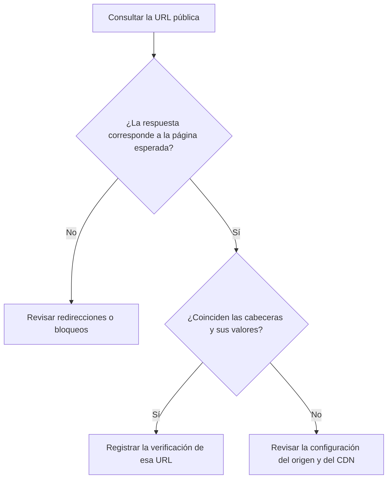

#  SecurityHeaders

[Volver al catálogo web](../README.md) · [Volver a la portada](../../README.md#qué-necesitas-resolver) · [Abrir SecurityHeaders](https://securityheaders.com/)

  
  

SecurityHeaders inspecciona las cabeceras de la respuesta HTTP que recibe desde Internet. Sirve para verificar si una página pública entrega las cabeceras que el equipo configuró en el servidor, el proxy inverso o el CDN.

## Comprobar cabeceras HTTP después de un cambio

**Situación.** El equipo activó nuevas cabeceras de seguridad en un portal detrás de un CDN. Necesitas comprobar qué devuelve la página pública tras el despliegue.

**Antes de empezar.** Ten a mano una URL pública de un sitio que administres o tengas autorización para evaluar, la lista de cabeceras esperadas y sus valores. El servicio recibe la URL que indiques. Usa una página sin autenticación y excluye tokens, identificadores internos y parámetros sensibles.

### Pasos

1. Introduce la URL HTTPS de la página que quieres verificar y ejecuta la consulta.
2. Comprueba el destino y el código HTTP. Si hay una redirección, anota la URL solicitada y la que responde al final. Si el servicio recibió una página de error o de bloqueo del CDN, revisa primero ese comportamiento.
3. Busca cada cabecera esperada en la respuesta y compara su **valor** con lo previsto. Registra el resultado por URL, ya que otras rutas y subdominios pueden responder de forma distinta.
4. Si falta una cabecera o el valor difiere, revisa con el equipo dónde se aplica la configuración. Contrasta, por canales autorizados, la respuesta que genera el origen con la que entrega el CDN. Después de corregir el cambio, vuelve a comprobar la misma URL.

### Cómo interpretar el resultado

| Hallazgo | Qué revisar |
| --- | --- |
| La respuesta HTTPS no incluye `Strict-Transport-Security`. | Comprueba si HSTS estaba previsto para ese sitio y en qué capa debía añadirse. Revisa la respuesta HTTPS final. |
| Solo aparece `Content-Security-Policy-Report-Only`. | La política está en modo de observación. Verifica si el despliegue debía aplicar una política de bloqueo mediante `Content-Security-Policy`. |
| Aparece `X-Content-Type-Options: nosniff`. | La cabecera está presente. Comprueba también que los recursos se sirvan con el tipo `Content-Type` adecuado si investigas errores de carga. |
| El resultado corresponde a una redirección o a una página de bloqueo. | Identifica qué respuesta estás leyendo y comprueba por separado la página que debía entregar las cabeceras. |

**Para el ticket**, registra la URL solicitada y la final, el código HTTP, la hora de la prueba y la diferencia entre los valores observados y los esperados. Usa la calificación del servicio como orientación y las cabeceras de la respuesta como evidencia del cambio.

Fuentes · [SecurityHeaders](https://securityheaders.com/) · [HSTS en MDN](https://developer.mozilla.org/en-US/docs/Web/HTTP/Reference/Headers/Strict-Transport-Security) · [CSP en modo de observación en MDN](https://developer.mozilla.org/en-US/docs/Web/HTTP/Reference/Headers/Content-Security-Policy-Report-Only) · [Verificación de tipos MIME en MDN](https://developer.mozilla.org/en-US/docs/Web/Security/Practical_implementation_guides/MIME_types)
