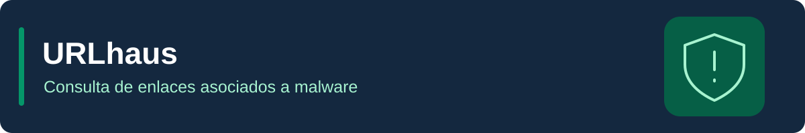
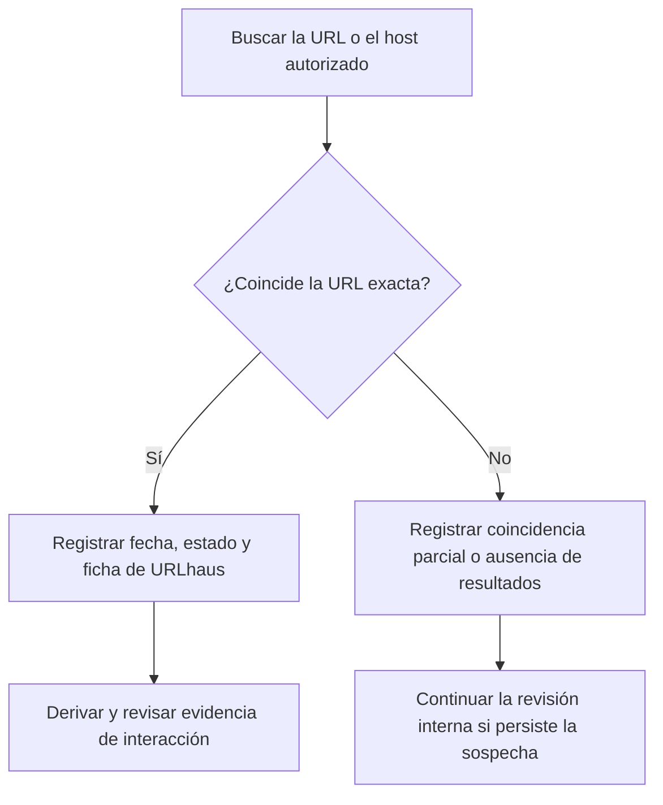

#  URLhaus

[Volver al catálogo web](../README.md) · [Volver a la portada](../../README.md#qué-necesitas-resolver) · [Abrir URLhaus](https://urlhaus.abuse.ch/browse/)

  
  

URLhaus, operado por abuse.ch y Spamhaus, recopila reportes de enlaces usados para distribuir malware. Puedes consultar registros existentes para determinar si un enlace observado en un correo o en una alerta ya fue reportado.

## Comprobar si un enlace está asociado a malware

**Situación.** Un usuario recibe un enlace de descarga inesperado. Soporte quiere saber si la dirección ya figura en reportes de distribución de malware.

**Antes de empezar.** Obtén la dirección como texto desde el reporte original. El buscador recibe lo que ingreses. Si la URL contiene tokens, datos personales o parámetros internos, conserva la versión completa en el canal interno y consulta únicamente el host público si puede compartirse.

### Pasos

1. Abre **Browse Database** y busca la URL si está autorizada para compartirse. También puedes buscar el host. Como ejemplo ilustrativo, puedes usar `descargas.example.com`.
2. Compara el resultado con el indicador original. Confirma el host y, si tienes la URL completa, el esquema y la ruta. Una coincidencia de host puede corresponder a otra descarga.
3. Si encuentras un registro pertinente, revisa la fecha de incorporación en UTC, el estado disponible y las etiquetas. Abre solo la ficha del registro dentro de URLhaus y deja la descarga fuera de la revisión.
4. Cruza el hallazgo con la evidencia interna. Distingue si el enlace solo se recibió o si existe evidencia de acceso, descarga o ejecución. Si hay señales de interacción o una coincidencia exacta, deriva el caso por el canal de respuesta.

### Cómo interpretar el resultado

| Hallazgo | Siguiente paso |
| --- | --- |
| La URL exacta figura como **Online**. | Registra la coincidencia y deriva el caso. Revisa la evidencia interna para determinar si un dispositivo se conectó o descargó un archivo. |
| La URL exacta figura como **Offline**. | Conserva el registro como evidencia histórica y compara su fecha con la actividad observada. |
| Coincide el host, pero la ruta es distinta. | Registra la relación como contexto y continúa la revisión de la URL original. |
| La búsqueda no arroja coincidencias. | Anota el alcance de la consulta y sigue por el canal interno si la sospecha persiste. |

**Para el ticket**, registra qué buscaste, la hora en UTC, el estado observado, el enlace a la ficha de URLhaus y el tipo de interacción del usuario si se conoce. Usa el identificador de la ficha como referencia y conserva la dirección sospechosa como texto sin enlace activo.

Fuentes · [Base de datos de URLhaus](https://urlhaus.abuse.ch/browse/) · [Acerca del proyecto](https://urlhaus.abuse.ch/about/)
