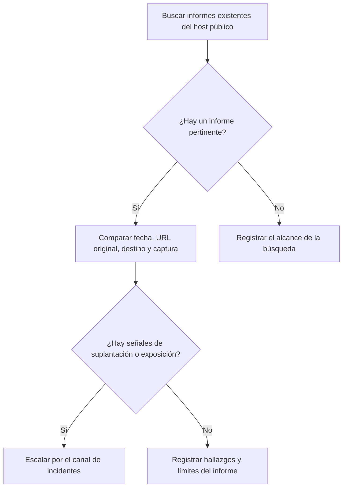

#  urlscan.io

[Volver al catálogo web](../README.md) · [Volver a la portada](../../README.md#qué-necesitas-resolver) · [Abrir la búsqueda de urlscan.io](https://urlscan.io/search/)

  
  

urlscan.io conserva informes de visitas realizadas por su servicio de análisis. Un informe existente permite revisar el destino, las redirecciones y la captura que se obtuvo en ese momento.

## Revisar un enlace sospechoso con un informe existente

**Situación.** Un usuario reenvía a soporte un correo inesperado que supuestamente lleva a un portal de inicio de sesión. Quieres revisar el enlace y decidir si corresponde escalarlo.

**Antes de empezar.** Usa la dirección que ya consta en el reporte del usuario y léela como texto. Para buscar en el servicio público, usa solo el nombre de host si es público y se puede compartir. Conserva internamente la URL completa si contiene tokens, identificadores o parámetros privados. Este caso usa informes existentes: confirma que estás en **Search**, donde se consulta el historial.

### Pasos

1. Busca el host que figura en el enlace. Un ejemplo ilustrativo de consulta para el host inicial es `task.domain:acceso.example.com`. La búsqueda puede abarcar más de un nombre, así que confirma el host exacto en cada resultado.
2. Abre un informe de **urlscan.io** y comprueba la fecha y el objetivo original. Si solo coincide el dominio, registra esa relación como contexto. Otra ruta del mismo dominio puede mostrar un contenido distinto.
3. Compara la URL original con la final e inspecciona la captura disponible dentro del informe. Una pantalla de inicio de sesión de una marca conocida merece revisión si el dominio final no corresponde a los dominios oficiales verificados por tu organización.
4. Si hay indicios de suplantación o el usuario ya entregó credenciales, deriva el caso por el canal interno de incidentes. Incluye el enlace al informe de urlscan.io cuando esté autorizado compartirlo.

### Cómo interpretar el resultado

| Hallazgo | Qué hacer |
| --- | --- |
| El informe muestra una página de acceso en un dominio distinto del esperado. | Verifica si ese dominio pertenece a un proveedor legítimo consultando una fuente conocida. Si la relación no se confirma, registra el indicio y escala. |
| El informe es antiguo o corresponde a otra ruta. | Anota qué parte coincide. El informe documenta lo observado durante esa visita. |
| La búsqueda no muestra resultados pertinentes. | Registra que no encontraste evidencia histórica utilizable y continúa la revisión por el canal interno. |

**Para el ticket**, registra el host inicial, el dominio final si consta, la fecha del informe, el enlace a la evidencia y si el usuario abrió el enlace o entregó información. Describe los indicios observados y conserva los datos sensibles en el canal interno.

Fuentes · [Historial de análisis en urlscan.io](https://docs.urlscan.io/pages/source-scans) · [Campos de búsqueda y redirecciones](https://urlscan.io/docs/search/)
