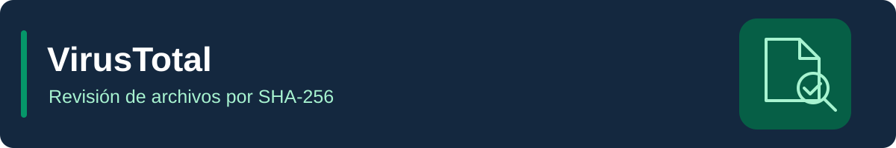
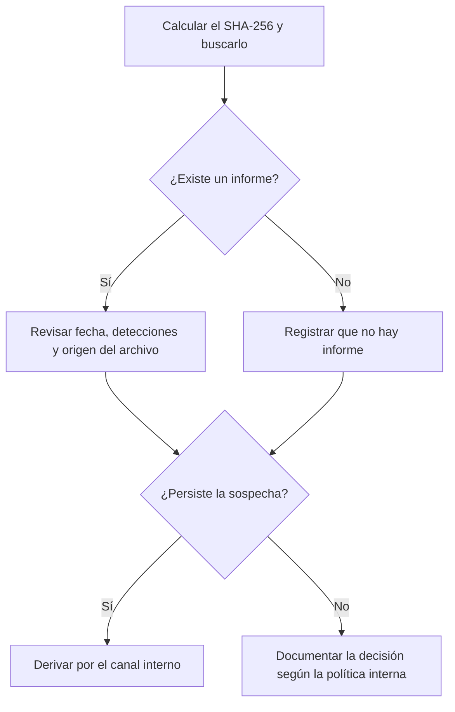

#  VirusTotal

<p align="center"></p>

[Volver al catálogo web](../README.md) · [Volver a la portada](../../README.md#qué-necesitas-resolver) · [Abrir VirusTotal](https://www.virustotal.com/gui/home/search)

<p align="center">
  <a href="../README.md"></a>
  <a href="#revisar-un-archivo-sospechoso-por-sha-256"></a>
</p>

VirusTotal reúne los resultados de distintos motores de seguridad. Puedes buscar un informe existente por el SHA-256 de un archivo. La búsqueda se realiza en un servicio externo y envía el hash consultado.

## Revisar un archivo sospechoso por SHA-256

**Situación.** Un usuario recibió un adjunto inesperado y necesita saber si puede abrirlo. Esta revisión permite buscar antecedentes sin ejecutar el archivo.

**Antes de empezar.** Usa una copia ya disponible en una ubicación aprobada para el análisis. Si el archivo contiene información interna o de clientes, sigue la política de tu organización antes de consultar su hash en un servicio externo. Mantén el archivo fuera de la opción de carga pública.

### Pasos

1. Calcula el SHA-256 localmente. En PowerShell, reemplaza la ruta de ejemplo por la del archivo que estás revisando.

   ```powershell
   Get-FileHash -LiteralPath 'C:\Revision\adjunto.pdf' -Algorithm SHA256
   ```

2. Copia el valor de **Hash** y pégalo en la pestaña **Search** de VirusTotal.
3. Si aparece un informe, verifica que el SHA-256 coincida y revisa la **fecha del último análisis**. Lee qué motores detectaron el archivo y cuáles fueron sus etiquetas. Conserva el contexto del ticket, como el origen del adjunto y si el usuario esperaba recibirlo.
4. Registra el resultado y deriva el caso según el procedimiento interno cuando la sospecha persista. Si alguien ya abrió el archivo, deja ese antecedente en el ticket y escala según corresponda.

### Cómo interpretar el resultado

| Resultado | Siguiente paso |
| --- | --- |
| Varios motores muestran detecciones consistentes. | Mantén el archivo sin abrir y deriva el caso con el hash y el enlace al informe. |
| Hay una detección aislada o etiquetas genéricas. | Revisa el origen y los antecedentes del adjunto. Una detección aislada puede ser un falso positivo. |
| El informe indica cero detecciones. | Revisa la fecha del análisis y verifica el origen. Cero detecciones por sí solas son insuficientes para autorizar la apertura. |
| La búsqueda no devuelve un informe. | Registra que no hubo coincidencias y continúa por el canal interno de análisis si la sospecha persiste. |



**Para el ticket**, incluye el SHA-256, la fecha de consulta, el enlace al informe cuando exista, las detecciones observadas y la acción tomada.

Fuentes · [Búsqueda por hash en VirusTotal](https://docs.virustotal.com/docs/searching) · [Interpretación de informes](https://docs.virustotal.com/docs/results-reports) · [Get-FileHash en Microsoft Learn](https://learn.microsoft.com/powershell/module/microsoft.powershell.utility/get-filehash)
